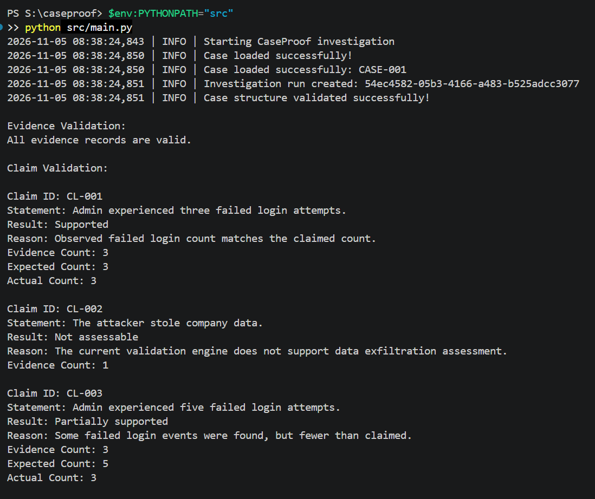
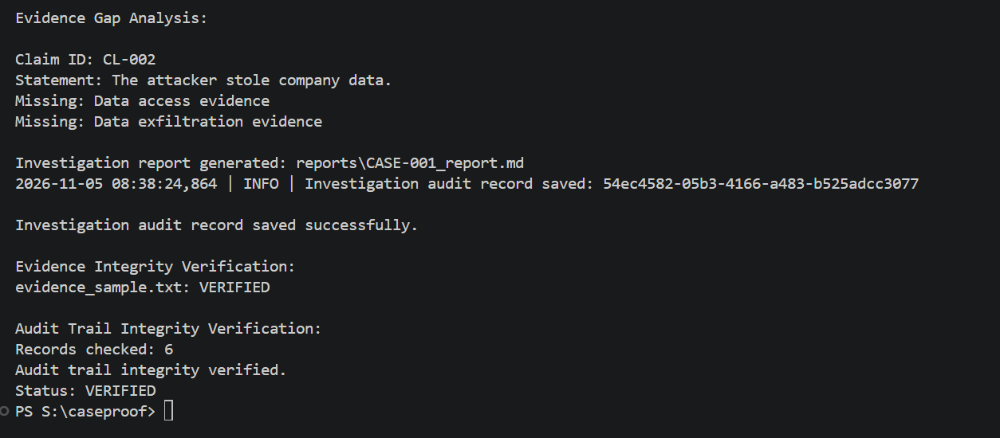
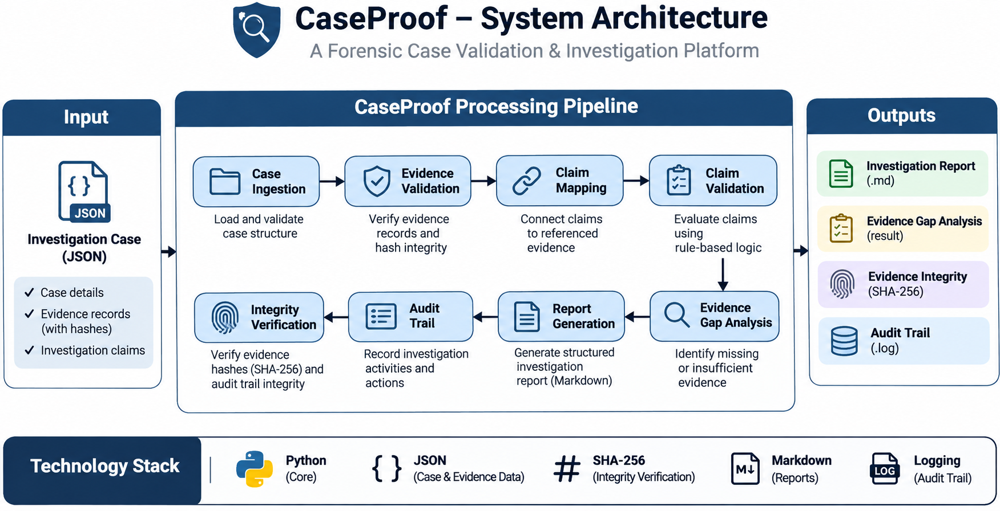

# CaseProof

### SOC Investigation Evidence Validation & Quality Auditor

CaseProof is a Python-based cybersecurity project designed to evaluate the quality and integrity of SOC investigation evidence. It validates investigation claims against referenced evidence, identifies evidence gaps, verifies evidence integrity using SHA-256 hashes, and maintains a hash-chained audit trail.

## Key Features

- **Case Ingestion:** Loads and validates structured JSON investigation cases.
- **Evidence Validation:** Checks evidence records for required fields, valid event types, and duplicate IDs.
- **Claim Validation:** Evaluates investigation claims against their referenced evidence using rule-based logic.
- **Evidence Gap Detection:** Identifies missing evidence needed to support investigation conclusions.
- **Evidence Integrity Verification:** Uses SHA-256 hashing to detect changes to evidence files.
- **Audit Trail:** Records investigation activity with unique run IDs and hash-chain integrity checks.
- **Investigation Reports:** Generates structured Markdown reports.
- **Application Logging:** Records application events and errors.

## Application Screenshots

### 1. Main Application Execution

Shows CaseProof loading an investigation case, validating evidence, and evaluating investigation claims.



### 2. Evidence and Audit Integrity Verification

Shows evidence gap analysis, investigation report generation, SHA-256 evidence verification, and audit trail integrity verification.



## System Architecture

The following diagram illustrates CaseProof's main components and how investigation data flows through the application.



## Technology Stack

- Python
- JSON
- SHA-256
- pytest
- Git

## Project Structure

```text
caseproof/
|-- data/
|   |-- evidence/
|   |-- sample_cases/
|   |-- schemas/
|-- docs/
|-- reports/
|-- src/
|   |-- caseproof/
|   |-- main.py
|-- tests/
|-- .gitignore
|-- README.md
|-- requirements.txt
```

## Getting Started

### Prerequisites

- Python 3.10 or later
- Git (optional, for cloning the repository)

### Installation

Clone the repository:

```bash
git clone https://github.com/Supreeth-A-cyber/caseproof.git
cd caseproof
```

Install dependencies:

```bash
pip install -r requirements.txt
```

### Run the Application

From the project root, run:

```powershell
$env:PYTHONPATH="src"
python src/main.py
```

### Run Tests

```powershell
$env:PYTHONPATH="src"
python -m pytest -v
```

## Security and Integrity

CaseProof uses SHA-256 hashes to verify whether evidence files have changed since their recorded integrity values were created.

Its audit trail uses a hash chain to detect modifications, deletions, and reordering of protected records.

**Important:** Hash-chain verification is tamper-evident, not tamper-proof. The current prototype does not use an external trusted anchor or digital signatures.

## Project Scope and Limitations

- This is an educational cybersecurity portfolio project.
- Claim validation currently supports specific rule-based scenarios.
- Data-exfiltration claims are not independently verified by the current validation engine.
- Results depend on the quality and completeness of the supplied evidence.
- The project is not a production forensic platform or a replacement for a SIEM or professional incident-response process.

## Future Improvements

- Support additional security event types.
- Expand structured claim validation.
- Improve evidence-gap detection.
- Add external audit integrity anchoring.
- Develop a web-based investigation interface.

## Author

**Supreeth A**

GitHub: https://github.com/Supreeth-A-cyber

LinkedIn: https://www.linkedin.com/in/supreeth-a-822a47411/

---

*Built as a hands-on cybersecurity portfolio project focused on SOC investigation quality, evidence integrity, and auditability.*